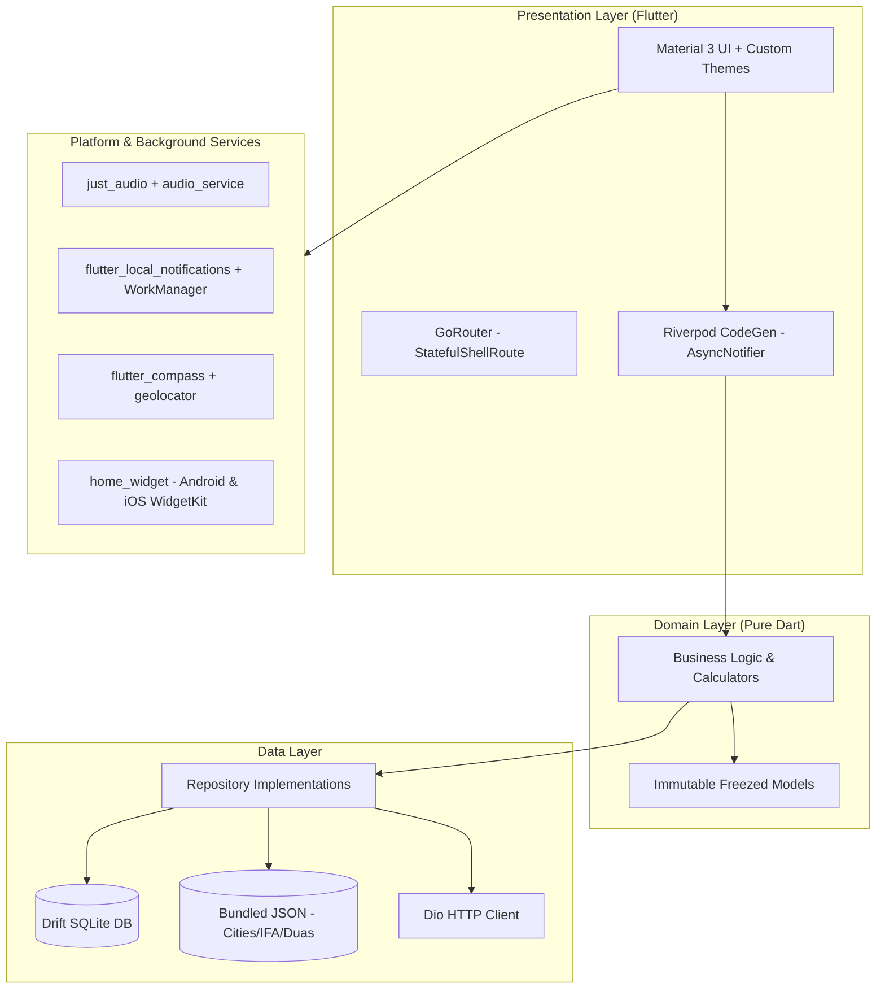
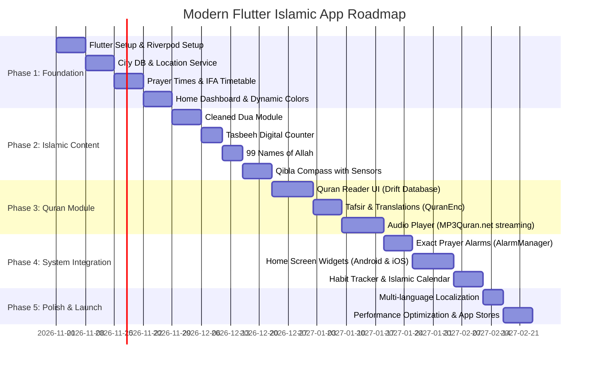

# Modern Flutter Architecture & Implementation Plan: Islamic Daily Companion App

> **Target Platform**: Android & iOS (Flutter 3.x+)  
> **Architecture Pattern**: Feature-First Clean Architecture  
> **State Management**: Riverpod 2.6+ (Code Generation & AsyncNotifier)  
> **Routing**: GoRouter (Type-safe, declarative with `StatefulShellRoute`)  
> **Local DB**: Drift (Type-Safe Reactive SQLite)  
> **Audio**: `just_audio` + `audio_service` (Background playback & lock screen controls)  

---

## 1. Modern Technology Stack & Dependencies

Here is the exact `pubspec.yaml` dependency suite recommended for this project:

```yaml
name: islamic_companion
description: "A modern, offline-first Islamic daily companion app."
publish_to: "none"
version: 1.0.0+1

environment:
  sdk: ">=3.3.0 <4.0.0"

dependencies:
  flutter:
    sdk: flutter
  flutter_localizations:
    sdk: flutter

  # --- State Management & Architecture ---
  flutter_riverpod: ^2.6.1
  riverpod_annotation: ^2.6.1

  # --- Navigation & Routing ---
  go_router: ^14.6.2

  # --- Data Modeling & Immutability ---
  freezed_annotation: ^2.4.4
  json_annotation: ^4.9.0

  # --- Local Database & Storage ---
  drift: ^2.24.2
  drift_flutter: ^0.2.4
  shared_preferences: ^2.3.4
  flutter_secure_storage: ^9.2.2

  # --- Islamic Engines ---
  adhan: ^2.1.0 # Official Batoul Apps Adhan Dart port
  hijri: ^3.0.0 # Hijri date calendar calculations

  # --- Geolocation & Sensors ---
  geolocator: ^13.0.2
  flutter_compass: ^0.8.0
  sensors_plus: ^6.1.1

  # --- Audio & Media ---
  just_audio: ^0.9.43
  audio_service: ^0.18.16

  # --- Notifications & Background ---
  flutter_local_notifications: ^18.0.1
  workmanager: ^0.5.2

  # --- UI & Widgets ---
  home_widget: ^0.7.0 # Android AppWidgets & iOS WidgetKit
  flutter_svg: ^2.0.17
  cached_network_image: ^3.4.1
  google_fonts: ^6.2.1

  # --- Networking ---
  dio: ^5.7.0
  dio_cache_interceptor: ^3.5.0

dev_dependencies:
  flutter_test:
    sdk: flutter
  flutter_lints: ^5.0.0
  build_runner: ^2.4.14
  riverpod_generator: ^2.6.3
  freezed: ^2.5.7
  json_serializable: ^6.9.0
  drift_dev: ^2.24.2
```

---

## 2. Architecture Overview: Feature-First Clean Architecture



---

## 3. Recommended Project Directory Structure

```
lib/
├── app/
│   ├── app.dart                   # MaterialApp.router configuration
│   ├── router/                    # GoRouter routes & navigation shell
│   │   ├── app_router.dart
│   │   └── scaffold_with_nav_bar.dart
│   └── theme/                     # Material 3 light/dark & prayer-aware themes
│       ├── app_colors.dart
│       ├── app_theme.dart
│       └── prayer_theme_extension.dart
│
├── core/                          # Cross-cutting utilities & services
│   ├── constants/                 # Asset paths, API endpoints, storage keys
│   ├── database/                  # Drift database tables, DAOs & migrations
│   │   ├── app_database.dart
│   │   └── daos/
│   ├── network/                   # Dio client, caching & interceptors
│   ├── services/
│   │   ├── location_service.dart     # Geolocator permissions & coordinates
│   │   ├── notification_service.dart # Local notifications & exact alarms
│   │   └── audio_handler.dart        # Background AudioService handler
│   └── utils/                     # Hijri date converters, time formatters
│
├── features/                      # Modular features (Clean Architecture per feature)
│   ├── prayer_times/
│   │   ├── data/                  # Adhan calculator, IFA timetable repo, City DB
│   │   ├── domain/                # PrayerTime entity, CalculationMethod enum
│   │   └── presentation/          # Dashboard, prayer cards, countdown timer
│   │
│   ├── quran/
│   │   ├── data/                  # Quran repository (Quran.com API / local DB)
│   │   ├── domain/                # Surah, Ayah, Tafsir, Qari models
│   │   └── presentation/          # Surah list, mushaf reader, audio player bar
│   │
│   ├── dua/
│   │   ├── data/                  # Cleaned bundled dua.json repository
│   │   ├── domain/                # Dua, DuaCategory models
│   │   └── presentation/          # Category grid, dua details, audio button
│   │
│   ├── qibla/
│   │   ├── domain/                # Azimuth & magnetic declination logic
│   │   └── presentation/          # Smooth 60fps compass dial UI
│   │
│   ├── tasbeeh/
│   │   ├── data/                  # Saved dhikr counts & history
│   │   └── presentation/          # Full-screen interactive tap counter
│   │
│   ├── names_of_allah/
│   │   ├── data/                  # 99 Names repository
│   │   └── presentation/          # Card list with audio and meanings
│   │
│   └── settings/
│       ├── domain/                # ThemeMode, CalculationSettings
│       └── presentation/          # Settings screen, language, IFA toggle
│
└── main.dart                      # Entry point, dependency initialization
```

---

## 4. Core Implementation Recipes

### A. Prayer Calculation Service (`adhan` + Bangladesh IFA)

```dart
import 'dart:convert';
import 'package:flutter/services.dart';
import 'package:adhan/adhan.dart';

class PrayerCalculationService {
  // 1. Global Mathematical Calculation using Batoul Apps Adhan
  PrayerTimes calculateGlobalTimes({
    required double latitude,
    required double longitude,
    required CalculationMethod method,
    required Madhab madhab,
    DateTime? date,
  }) {
    final coordinates = Coordinates(latitude, longitude);
    final params = method.getParameters();
    params.madhab = madhab;

    return PrayerTimes(
      coordinates,
      DateComponents.from(date ?? DateTime.now()),
      params,
    );
  }

  // 2. Bangladesh Islamic Foundation (IFA) Timetable (From bundled ifa_times.json)
  Future<Map<String, String>?> getIFATimes({
    required String districtCode,
    required DateTime date,
  }) async {
    final jsonStr = await rootBundle.loadString('assets/data/ifa_times.json');
    final data = json.decode(jsonStr) as Map<String, dynamic>;
    
    // Day of year lookup in 365-day schedule
    final districtSchedule = data[districtCode] as List<dynamic>?;
    if (districtSchedule == null) return null;

    final monthIndex = date.month - 1;
    final dayIndex = date.day - 1;
    
    final dayData = districtSchedule[monthIndex][dayIndex] as Map<String, dynamic>;
    return {
      'sehri': dayData['s'] as String,
      'fajr': dayData['fs'] as String,
      'iftar': dayData['i'] as String,
    };
  }
}
```

### B. Smooth Qibla Compass Calculation

```dart
import 'package:adhan/adhan.dart';
import 'package:flutter_compass/flutter_compass.dart';

class QiblaService {
  double getQiblaBearing(double userLat, double userLng) {
    final coordinates = Coordinates(userLat, userLng);
    return Qibla(coordinates).direction;
  }

  Stream<double>? getHeadingStream() {
    return FlutterCompass.events?.map((event) => event.heading ?? 0.0);
  }
}
```

### C. Streaming Quran Recitations (MP3Quran.net via `just_audio`)

```dart
import 'package:just_audio/just_audio.dart';

class QuranAudioService {
  final AudioPlayer _player = AudioPlayer();

  Future<void> playSurah({
    required String reciterServer, // e.g. "https://server11.mp3quran.net/sds/"
    required int surahNumber,
  }) async {
    final formattedNumber = surahNumber.toString().padLeft(3, '0');
    final url = '$reciterServer$formattedNumber.mp3';

    await _player.setUrl(url);
    await _player.play();
  }

  Future<void> stop() => _player.stop();
  Future<void> pause() => _player.pause();
  Stream<PlayerState> get playerStateStream => _player.playerStateStream;
}
```

---

## 5. Offline Data Bundling Checklist

Place these files in your Flutter `assets/` directory and declare them in `pubspec.yaml`:

1. `assets/data/countries+cities.json` (10.7 MB, offline world coordinates).
2. `assets/data/calculation_method_for_countries.json` (Country to Fiqh school mapping).
3. `assets/data/ifa_times.json` (Bangladesh official 365-day schedule for 64 districts).
4. `assets/data/dua_bn.json` & `assets/data/dua_en.json` (Cleaned 130 Duas in 6 categories).
5. `assets/data/names_data.json` (99 Names of Allah with meaning & Quran references).
6. `assets/fonts/uthmani_hafs.ttf` & `assets/fonts/kalpurush.ttf` (Arabic & Bengali fonts).

---

## 6. Development Execution Roadmap (14 Weeks)



---

## 7. Next Steps

1. Run `flutter create --org com.yourdomain --platforms=android,ios islamic_companion`.
2. Add the dependencies from Section 1 into `pubspec.yaml`.
3. Copy the offline JSON assets into `assets/data/`.
4. Implement the feature modules following the feature-first directory layout in Section 3.

